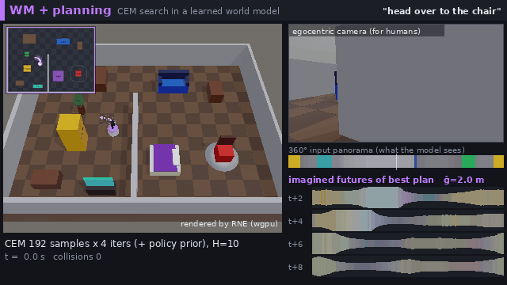
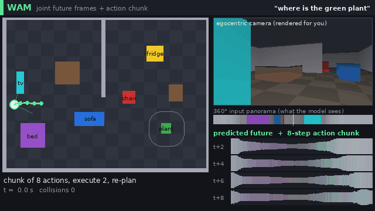
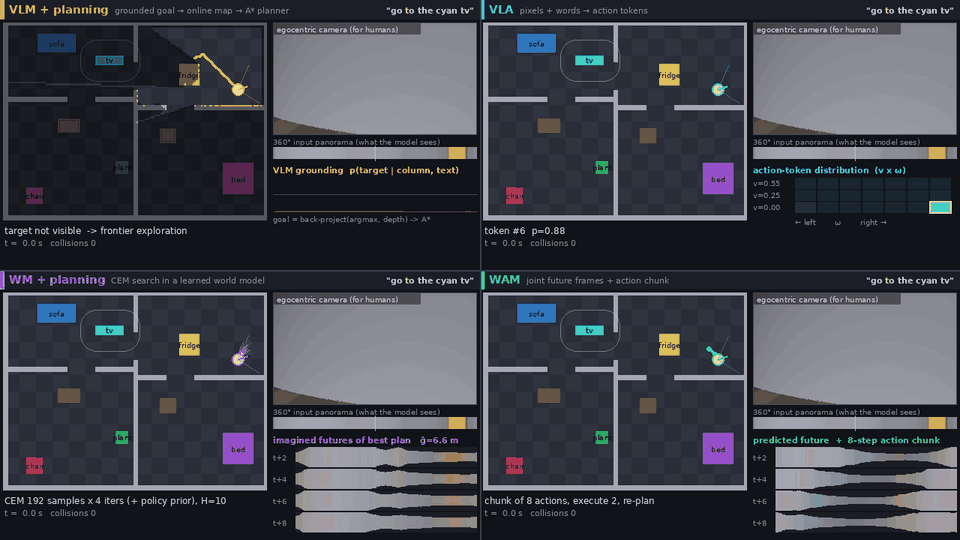
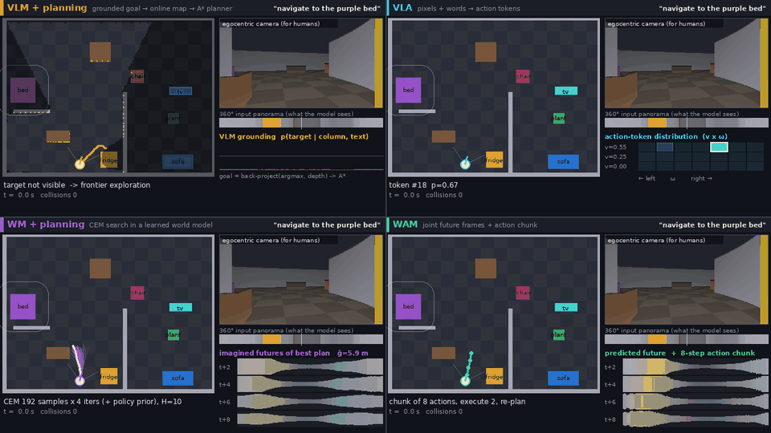
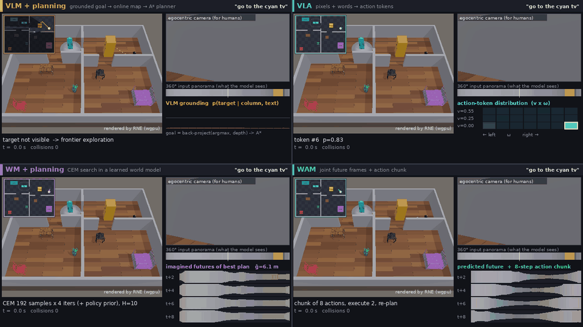
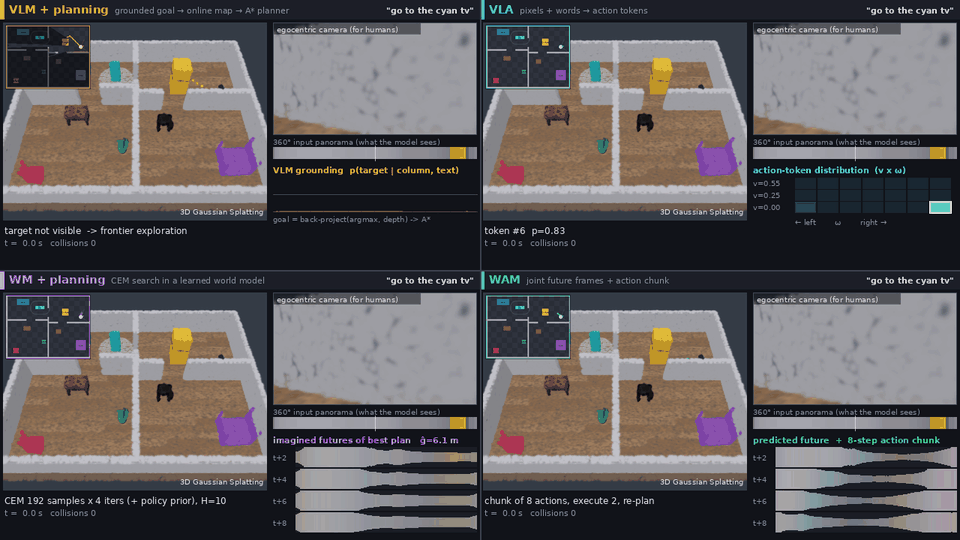
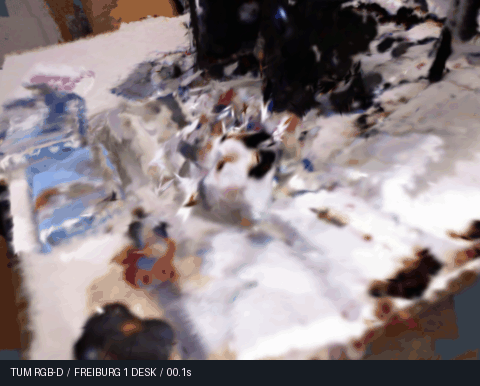
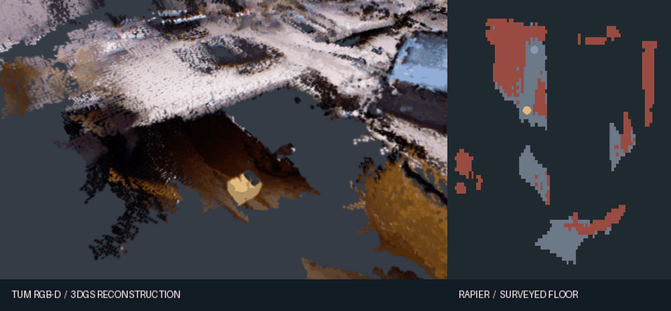
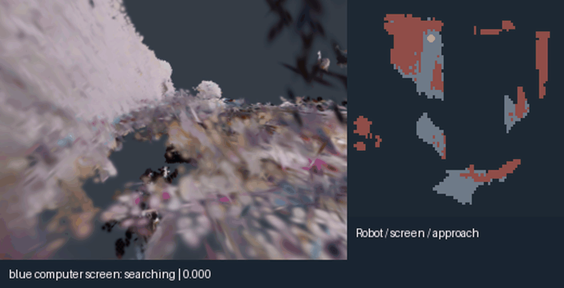

# Navigation Foundation Model

[](https://github.com/rsasaki0109/navigation-foundation-model/actions/workflows/ci.yml)

**Four ways to turn "head over to the chair" into motion, side by side in one simulator.**

<p align="center">
  
  <br><sub>Same episode (held-out seed 35), same instruction, four paradigms. The 3D views are rendered by [Robot Native Engine](https://github.com/rsasaki0109/RobotNativeEngine)'s wgpu PBR renderer from the live simulation state. The inset is the top-down map, and the right column of each panel shows what each model is thinking.</sub>
</p>

<table>
  <tr>
    <td width="50%" align="center">
      <br>
      <b>VLM + planning</b><br>
      <sub>A language-grounded detector scores every panorama column for the instructed object; the hit is back-projected with depth into an online occupancy map, and a classical A* planner + pure pursuit drives there. No target in view → frontier exploration.</sub>
    </td>
    <td width="50%" align="center">
      <br>
      <b>VLA (vision-language-action)</b><br>
      <sub>One network maps pixels + words straight to a distribution over 21 discrete (v, ω) action tokens, RT-style. No map and no planner. It is trained by behaviour cloning and then DAgger.</sub>
    </td>
  </tr>
  <tr>
    <td width="50%" align="center">
      <br>
      <b>WM + planning (world model + MPC)</b><br>
      <sub>A latent world model (encoder, action-conditioned dynamics, decoder, goal-distance and collision heads) is searched with CEM: 192 imagined action sequences × 4 iterations every step, seeded by a latent policy prior (TD-MPC style). The map shows the sampled plans; the strips are decoded imagined futures.</sub>
    </td>
    <td width="50%" align="center">
      <br>
      <b>WAM (world-action model)</b><br>
      <sub>One trunk jointly predicts an 8-step action chunk <i>and</i> the panoramas it expects to see at t+2…t+8. Predicting the future acts as an auxiliary signal for the actions. It executes 2 actions, then re-plans.</sub>
    </td>
  </tr>
</table>

## Results

Held-out evaluation on 100 episodes (seeds 0–99; training uses seeds ≥ 100 000, so layouts, object placements, start poses and instruction phrasings are unseen):

| Paradigm | Success | SPL | Steps to goal (successes) | Collisions / episode | Params |
| --- | ---: | ---: | ---: | ---: | ---: |
| VLM + planning | **0.99** | 0.90 | 48.8 | **0.00** | 0.11 M (+ classical planner) |
| ↳ grounding by **pretrained CLIP ViT-B/32, zero-shot** (ray-cast views) | 0.80 | 0.59 | 74.1 | 0.10 | 151 M, not trained here |
| ↳ same, CLIP sees RNE-rendered views (40 episodes) | 0.70 | 0.54 | 64.1 | 0.10 | 151 M, not trained here |
| VLA | 0.94 | 0.92 | **38.3** | 0.06 | 0.69 M |
| WM + planning | 0.80 | 0.63 | 60.6 | 0.35 | 0.73 M (+ CEM) |
| ↳ policy prior only (no planning) | 0.87 | — | — | 6.76 | same network |
| WAM | **0.99** | **0.96** | 41.0 | 0.40 | 2.56 M |

`docs/results.json` has per-episode numbers (`python scripts/evaluate.py 100`).

What the numbers say, in this toy setting:

- **VLM + planning** is the most robust and never touches furniture. It is the only method with memory: a map built from depth, plus frontier exploration when the target is hidden behind a wall. The price is speed, because exploring costs steps.
- **A real foundation model drops in zero-shot.** Replacing the trained grounding net with OpenAI's CLIP ViT-B/32 changes nothing else. Every 4 steps the robot renders 8 camera crops around itself, CLIP scores each against the instruction rewritten as a caption (*"take me to the red chair"* becomes *"a photo of a red chair"*) and against background captions, and the same map and A* planner drive. It reaches 0.80 without seeing a single frame of this world in training. It explores more, because CLIP picks the right direction for only about half the crops, and the planner drops a goal once it has stood there 6 steps without arriving. It does better on the flat-coloured ray-cast views than on the RNE renders (0.70): the RNE furniture models are less canonical-looking than "a red chair" (`navfm/clip_vlm.py`, agent kinds `clip_raycast` / `clip`).
- **WAM** matches it on success and takes the most efficient paths (best SPL). It is a reactive policy like the VLA. Predicting the future panoramas along with an 8-step action chunk acts as an auxiliary task that shapes its representation.
- **VLA** is the fastest per episode but fails more often (6 of 100). Its discrete action tokens are coarse, and it has no memory or look-ahead.
- **WM + planning** shows what planning buys and what it costs. The same network's policy prior alone reaches the goal slightly more often (0.87) but bumps into furniture about 20× more (6.8 vs 0.35 collisions per episode). Searching 10 imagined steps ahead with the collision head keeps it clear. The cost is success: when the learned goal-distance head is wrong, CEM optimises toward the error.

## Engineering notes

Getting four learners to work on one simulator mostly meant fixing the data rather than the models:

| Problem | Symptom | Fix |
| --- | --- | --- |
| World model trained on expert demos only | CEM drives into states whose imagined outcome is wrong (model exploitation). Success ~0.2. | Train on the planner's own rollouts (0.39), then on planner-style *counterfactual* action sequences executed in the true simulator, and seed CEM with a latent policy prior (0.79) |
| Expert aimed 0.6 m ahead along the distance field | It cut corners, so DAgger taught the imitators to keep pushing into furniture | Aim at the farthest waypoint in line of sight; turn in place before a collision |
| Expert's turn-in-place direction flipped sign between neighbouring states | WAM's regression head averaged left and right into "drive straight" | Always turn toward increasing clearance |
| Blocked moves froze the robot | Corner deadlocks: 100+ collisions in an episode | Slide along obstacles like Habitat's `allow_sliding` (still counted as a collision) |
| *Tried, did not help:* WM failures that remain (20 of 100: 4 stall just short of the object, 3 trust a hallucinated "almost there", 4 never see the target, 9 run out of time otherwise) | — | A 5-head bootstrap ensemble of distance heads on the frozen model, plus a target-proximity head. Used as the mean, success fell to 0.70; as a disagreement penalty on the original head, it stayed at 0.80 on 40 episodes. Off by default (`WMPlannerAgent.USE_ENS`). Memory or a better-calibrated value probably matter more |
| *Tried, did not help either:* give the world model memory | — | A recurrent, RSSM-style world model (`RecurrentWorldModel`, kind `rwm`): a GRU state folds in each observation, and imagination continues from it. Trained on 24-step sequences, with counterfactual branches that keep their real history. Carrying the state through a whole episode drifted past what it was trained on (success 0.44). Re-filtering a 16-step window each step recovers most of it: success 0.75, SPL 0.49, 7.2 collisions on 100 episodes, still behind the feedforward model above (0.80, SPL 0.63, 0.35 collisions) |
| *…and trained on whole episodes:* the recurrent model's state drifted because the windows it trained on started mid-episode from an empty state | — | Train on whole episodes from their start, with the state carried as at deployment and imagined 8-step branches every 4 steps (`train_rwm_episodes`, kind `rwm_ep`). With expert-mixed DAgger it fell to 0.27: once off the expert's path, its state "believed" it had arrived (predicted 0.1 m, true 4.8 m) and stopped. Pure on-policy rounds, which add its own long failures, raised it to 0.63 (SPL 0.45, 0.3 collisions) after 3 rounds. Three more rounds made it worse (round success 0.60 → 0.55 → 0.38, evaluation 0.34), so the shipped `rwm_ep.pt` is the round-3 model. Memory needs far more, and more diverse, on-policy data than the feedforward model |

## Harder layout, and real physics

### House and physics replays

| Multi-room house (seed 53) | RNE Rapier physics (seed 17) |
| --- | --- |
|  |  |

All four agents reach the cyan TV, which is out of view at the start of the house episode. Both replays use the built-in ray caster for the camera views. The physics replay takes its poses from Rapier.

```bash
NAVFM_CKPT=checkpoints/house python scripts/make_gifs.py 53 --layout house --raycast
python scripts/make_gifs.py 17 --physics rne --raycast
```

#### Multi-room house on Rapier, rendered in 3D



On seed 53, all four agents use the house checkpoints to reach the initially hidden cyan TV with zero collisions. RNE's wgpu renderer adds Poly Haven furniture meshes, plank flooring, lighting, and shadows. The agents use the simulator's ray-cast panoramas for observations.

```bash
# Build the RNE renderer as shown in Quickstart.
NAVFM_CKPT=checkpoints/house python scripts/make_gifs.py 53 --layout house --physics rne
```

#### 3D Gaussian Splatting replay



The 3DGS view samples the room and furniture surfaces into oriented Gaussians, projects their covariances into each camera, and composites the splats in depth order. Robot poses come from the same seed-53 Rapier episodes. The model uses the simulation geometry and baked colors.

```bash
# On Linux, install a C++17 compiler and the optional mesh loader.
pip install trimesh==4.11.3
NAVFM_CKPT=checkpoints/house python scripts/make_gifs.py 53 --layout house --physics rne --3dgs
```

#### 3DGS from real RGB-D measurements



The desk reconstruction fuses Kinect RGB and metric depth using the benchmark's time-stamped motion-capture poses. Surface normals orient the Gaussians and the RGB frames supply their colors. Replay cameras use alternating poses reserved from fusion. The PLY contains depth-fused Gaussians with degree-zero color and is suitable as an initialization for photometric optimization. This capture replay follows the recorded sensor poses.

Source data and derived PLY and GIF are attributed to Jürgen Sturm, Nikolas Engelhard, Felix Endres, Wolfram Burgard, and Daniel Cremers, *A Benchmark for the Evaluation of RGB-D SLAM Systems* (IROS 2012). The source data is [TUM RGB-D Freiburg 1 desk](https://cvg.cit.tum.de/data/datasets/rgbd-dataset) under [CC BY 4.0](https://creativecommons.org/licenses/by/4.0/).

```bash
# Requires the core Python dependencies and a C++17 compiler.
curl -fLO https://cvg.cit.tum.de/rgbd/dataset/freiburg1/rgbd_dataset_freiburg1_desk.tgz
python scripts/rgbd_splat.py rgbd_dataset_freiburg1_desk.tgz docs/media/tum_desk_3dgs.gif
```

The script writes the GIF, an uncompressed Gaussian PLY, and reconstruction metadata. The [committed PLY](docs/media/tum_desk_3dgs.ply.gz) is gzip-compressed.

#### Rapier simulation in the reconstructed desk scene



The same Gaussian PLY supplies a fitted floor and 5 cm obstacle cells. The route uses observed floor with at least 13 cm of map clearance. A joint-driven differential-drive robot follows it in Rapier. The map shows obstacle cells in red, surveyed free floor in grey, the robot in yellow, and the goal in green. The camera shows the registered reconstruction and the simulated robot.

The replay uses 55% of the original Gaussian width. On eight camera views reserved from fusion, measured at 320 × 240 over valid Kinect depths of 0.45–4.5 m, this increased mean RGB PSNR from 12.84 to 13.49 dB and luminance-gradient magnitude correlation from 0.228 to 0.247. Narrower splats leave more gaps where scan coverage is sparse.

```bash
pip install trimesh==4.11.3
python scripts/simulate_rgbd.py docs/media/tum_desk_3dgs.ply.gz docs/media/tum_desk_rapier.gif
```

This command also requires the RNE Python wheel. The accompanying JSON records the registration, Rapier trajectory, and final goal error. The scan and derived visualization use the TUM RGB-D attribution above.

#### Find the blue screen from the robot camera



The instruction is to approach the blue computer screen. The robot turns to search, then explores reachable surveyed floor if its first sweep comes up empty. Color proposes blue regions, and the pretrained OWLv2 detector checks whether they resemble a screen. Depth from the rendered splats back-projects the detected region into the registered map. A four-connected grid planner chooses and follows a reachable floor approach point. The episode uses the simulated robot pose and the surveyed obstacle map. The screen coordinates are estimated during the episode.

This is one scene-specific proof of concept. The color rule, score threshold, camera mast height, and start location are configured for this scene. The JSON logs each camera probe and control step, the estimated screen position, and the final approach error. The native contact count includes wheel contacts with the ground. The replay's first eight camera probes found no usable target. Probe nine localized the screen. The robot reduced its horizontal distance to that estimate from 0.92 m to 0.76 m and ended 1.9 cm from the floor approach point. The closest distance from the robot center to a collider was 9.9 cm. The 10 cm circular footprint check flagged 80 physics ticks, so the run records those as possible overlaps. The native contact count does not separate floor contacts from obstacle contacts.

```bash
# For the CPU PyTorch 2.8.0 setup in Quickstart.
pip install torchvision==0.23.0 --index-url https://download.pytorch.org/whl/cpu
pip install transformers==4.55.4
python scripts/navigate_rgbd.py docs/media/tum_desk_3dgs.ply.gz docs/media/tum_desk_visual_nav.gif
```

The command also needs the RNE Python wheel and C++17 compiler. The pretrained detector is fetched on first use. The scan and derived visualization use the TUM RGB-D attribution above.

#### Ten-start evaluation

The same detector, threshold, map and controller were run at five surveyed floor locations with yaw 0 and π at each location. A run counted as a correct localization if the estimated screen was within 25 cm of the visually checked reference from the original replay. Reaching required a correct localization, under 5 cm of final error to the computed approach point, and a final base-to-screen distance no greater than 85 cm. These are repeatability checks in one capture.

| Result | Count |
| --- | ---: |
| Screen candidate grounded | 10 / 10 |
| Correct screen localized | 8 / 10 |
| Approach completed | 8 / 10 |
| Run with a positive-impulse obstacle contact | 0 / 10 |

Runs 3 and 4 share the same starting location and accepted a small blue patch about 1.27 m from the screen reference. Run 4 also had a view of the actual screen at probe 3. OWLv2 scored that proposal 0.008, below the 0.012 acceptance threshold. The later false region scored 0.017. This failure involves target discrimination and the policy accepting the first qualifying view.

The [run log](docs/results_rgbd_navigation.json) includes the contact entities, normal impulses, and each camera probe. The [probe sheet](docs/results_rgbd_navigation.jpg) shows each initial view and the strongest candidates, with amber proposals and a green accepted region. Wheel–floor contacts were observed in every run. Obstacle onsets count positive normal impulses between a robot body and a named scan collider after a tick without that same pair.

```bash
# Use an RNE Python wheel with DiffDriveSim.contact_pairs.
python scripts/evaluate_rgbd_navigation.py docs/media/tum_desk_3dgs.ply.gz docs/results_rgbd_navigation.json
```

#### Two-view confirmation

The optional policy prefers a lateral move to a reachable floor cell 12–25 cm away. It checks that the robot actually moved at least 10 cm, points the camera at the candidate, and reruns the same detector. It accepts the mean of the two 3D estimates when their separation is at most 15 cm. A missing or inconsistent second observation sends the robot back to its search.

| Start conditions | Policy | Reached | Wrong accepted target | Runs with obstacle contact | Mean simulated time |
| --- | --- | ---: | ---: | ---: | ---: |
| Original ten | Single view | 8 / 10 | 2 | 0 | 28.8 s |
| Original ten | Two views | 7 / 10 | 0 | 1 | 62.5 s |
| Ten unused poses | Single view | 9 / 10 | 1 | 0 | 30.6 s |
| Ten unused poses | Two views | 7 / 10 | 0 | 0 | 86.5 s |

The unused poses are five different floor cells in the same scan, each tested at headings −90° and +90°. Times include the entire simulated episode and exclude inference and rendering latency. Confirmation moves and turns averaged 13.9 s and 22.5 s per run on the original and unused poses, respectively. The original set recovered run 3 and retained six of eight baseline successes. Its five rejected confirmations all lacked an above-threshold second detection. Run 6 recorded a positive-impulse contact between the base and a scan collider and ended on a turn timeout. Single-view navigation remains the default in this scene.

```bash
python scripts/evaluate_rgbd_navigation.py docs/media/tum_desk_3dgs.ply.gz docs/results_rgbd_two_view.json --confirm-views
python scripts/evaluate_rgbd_navigation.py docs/media/tum_desk_3dgs.ply.gz docs/results_rgbd_held_out.json --confirm-views --unseen
```

Remove `--confirm-views` to reproduce the single-view controls. Trial data and probe sheets are available for the [original starts](docs/results_rgbd_two_view.json), [original probes](docs/results_rgbd_two_view.jpg), [unused starts](docs/results_rgbd_held_out.json), and [unused probes](docs/results_rgbd_held_out.jpg). The timed controls are recorded for the [original starts](docs/results_rgbd_baseline.json) and [unused starts](docs/results_rgbd_held_out_baseline.json).

### A multi-room house

`NavEnv(seed, "house")` builds three or four rooms. They are separated by full walls with 0.9 m doors, and every start is at least 4 m from the goal along the path. The target is in view at the start in 12.5% of episodes, against 33% in the apartment. Success rate over 100 held-out episodes in each setting:

| Paradigm | House, apartment-trained (zero-shot) | House, fine-tuned on a 50/50 apartment + house mix | Apartment, same mix-trained model |
| --- | ---: | ---: | ---: |
| VLM + planning | 0.91 | 0.91 (no learned motion to retrain) | 0.99 |
| VLA | 0.70 | 0.88 | 0.95 |
| WAM | 0.80 | **0.94** | 0.98 |
| WM + planning | 0.58 | 0.67 (10 collisions/episode) | 0.86 |
| WM with memory (recurrent) | 0.63 | 0.29: on-policy training collapsed again; the apartment model is kept | 0.29 |

- Only the method with an explicit map transfers without retraining. VLM + planning explores frontiers room by room and loses almost nothing. The reactive VLA and WAM, and the world-model planner, drop 10–25 points.
- A little house data fixes the reactive policies. After fine-tuning on the mix, WAM is the best method in the house (0.94), and the apartment numbers do not regress (VLA 0.95, WAM 0.98, WM 0.86).
- The recurrent world model is the only learned method whose zero-shot house score equals its apartment score (0.63 in both), so its memory does carry across rooms. Its on-policy fine-tuning is unstable, though, and fell to 0.29 here just as it did in the apartment.

Numbers are in `docs/results_house_zeroshot.json`, `docs/results_house_trained.json` and `docs/results_house_trained_on_apartment.json`. Retrain with `scripts/train_house.sh`, which writes to `checkpoints/house/`.

### On Robot Native Engine physics

`navfm/rne_physics.py` runs the same episodes in RNE's Rapier physics. It exports the layout as a `.rne.scene.toml` of fixed box obstacles and drives a joint-driven differential-drive robot (wheel radius 6 cm, track 28 cm). Each 0.25 s step is 15 ticks at 60 Hz. Wheel motors, slip, inertia and contacts are therefore RNE's, not the unicycle model the policies were trained on. The expert succeeds in every episode with no collisions. The apartment-trained models, with no retraining, over 100 episodes:

| Paradigm | Python sim | RNE physics | Collisions / episode in RNE |
| --- | ---: | ---: | ---: |
| VLM + planning | 0.99 | 0.97 | 0.0 |
| VLA | 0.94 | 0.98 | 0.7 |
| WAM | 0.99 | 0.90 | 11.2 |
| WM + planning | 0.80 | 0.71 | 7.3 |

The closed-loop methods barely notice the change of dynamics, because they replan every step. WAM executes 2 actions open-loop from each chunk, and the world-model planner relies on dynamics learned from the unicycle model. Wheel slip that neither expected costs both of them success and collisions. Run with `python scripts/evaluate.py 100 --physics rne`. This needs the `rne_py` wheel built from RobotNativeEngine (`maturin build -m crates/rne_py/Cargo.toml`), which provides `DiffDriveSim.from_scene`.

## The simulator

`navfm/world.py` is a small, deterministic object-goal navigation world:

- **Apartment:** randomly generated, 8 m × 6 m. It has tall partial walls that block sight, low furniture that blocks motion but not sight, and six coloured target objects (chair, sofa, plant, fridge, bed, tv).
- **Robot:** a unicycle-model robot with radius 0.18 m and 0.25 s control steps, commanded by velocity (v, ω). A blocked move slides along the obstacle and counts as a collision.
- **Observation:** a 360° ray-cast panorama of 128 columns × (RGB + two depth layers), plus odometry and a free-form instruction such as *"take me to the red chair"* or *"find the fridge"*.
- **Success:** the robot comes within 0.5 m of the instructed object within 160 steps.
- **Expert:** a privileged expert (geodesic distance field + line-of-sight pure pursuit) produces demonstrations and DAgger labels. It succeeds in 100% of episodes with zero collisions.

The 3D views in the GIFs are for humans. The overview shows the plans as glowing dots: the A* path, the CEM samples and the best plan, or the WAM action chunk. The models only ever see the 128-column panorama strip shown under the egocentric camera.

**Rendering.** `navfm/rne_scene.py` exports every frame as a scene of primitives and [Poly Haven](https://polyhaven.com/models) CC0 furniture models (`assets/polyhaven`, fetched by `scripts/fetch_polyhaven.py`). Each model is fitted to its object's footprint and turned to face the room, and the six instructable objects are drawn in their instruction colour. Robot Native Engine's [`examples/150_scene_replay_render`](https://github.com/rsasaki0109/RobotNativeEngine/tree/main/examples/150_scene_replay_render) renders each frame with wgpu. No GPU is needed: Mesa's llvmpipe software Vulkan driver renders a frame in about 50 ms. If the RNE binary is not found, `make_gifs.py` falls back to a built-in ray caster.

## Quickstart

```bash
# Python 3.12, CPU
pip install torch==2.8.0 --index-url https://download.pytorch.org/whl/cpu
pip install -r requirements.txt pytest

python -m pytest -q tests                # simulator, expert, scene export; shipped checkpoints reproduce docs/results.json on the hero seeds
python scripts/evaluate.py 20            # evaluate the shipped checkpoints
# GIFs with RNE rendering (sibling checkout of RobotNativeEngine; on a GPU-less box: apt install mesa-vulkan-drivers)
(cd ../RobotNativeEngine && cargo build --release -p scene_replay_render --example 150_scene_replay_render)
python scripts/make_gifs.py 35           # or RNE_REPLAY_BIN=/path/to/150_scene_replay_render; --raycast for no RNE

# retrain everything from scratch (CPU, ~1-2 h total)
python scripts/collect.py 2500 data/expert.npz
python scripts/train.py vlm wm vla wam
```

### Optional dependencies

- Install `transformers` with `pip install transformers` for the CLIP agents (`clip_raycast` and `clip`). The pretrained ViT-B/32 weights are downloaded on first use.
- Install an `rne_py` wheel exposing `DiffDriveSim.from_scene` for Rapier physics (`--physics rne`). Build it from [Robot Native Engine](https://github.com/rsasaki0109/RobotNativeEngine/tree/eab0161edc7090bb83b5a956afc24ac5c699acdb) with `maturin build --release --locked -m crates/rne_py/Cargo.toml` and install the resulting wheel with pip.

## Layout

| Path | What |
| --- | --- |
| `navfm/world.py` | simulator: layouts, ray casting, dynamics, observations |
| `navfm/expert.py` | geodesic-field expert used for demonstrations / DAgger labels |
| `navfm/models.py` | the four networks (shared circular-conv panorama encoder + text encoder) |
| `navfm/agents.py` | deployable agents: grounding + A*, token policy, CEM-MPC, chunked WAM |
| `navfm/train.py`, `scripts/train.py` | training loops, DAgger / on-policy fine-tuning |
| `navfm/render.py`, `navfm/rne_scene.py`, `scripts/make_gifs.py` | hero GIF panels; RNE scene export |
| `checkpoints/` | trained weights used for the GIFs and the table |

## Scope

These models are deliberately tiny (0.1–2.6 M parameters, trained on a CPU) so that the whole pipeline can be rerun and inspected in an afternoon. They implement the architectural *paradigms* behind VLM-based planners, VLAs, world-model planners and world-action models. They are not pretrained foundation models, and the numbers above compare paradigms in this toy world, not published systems.

## License

MIT
