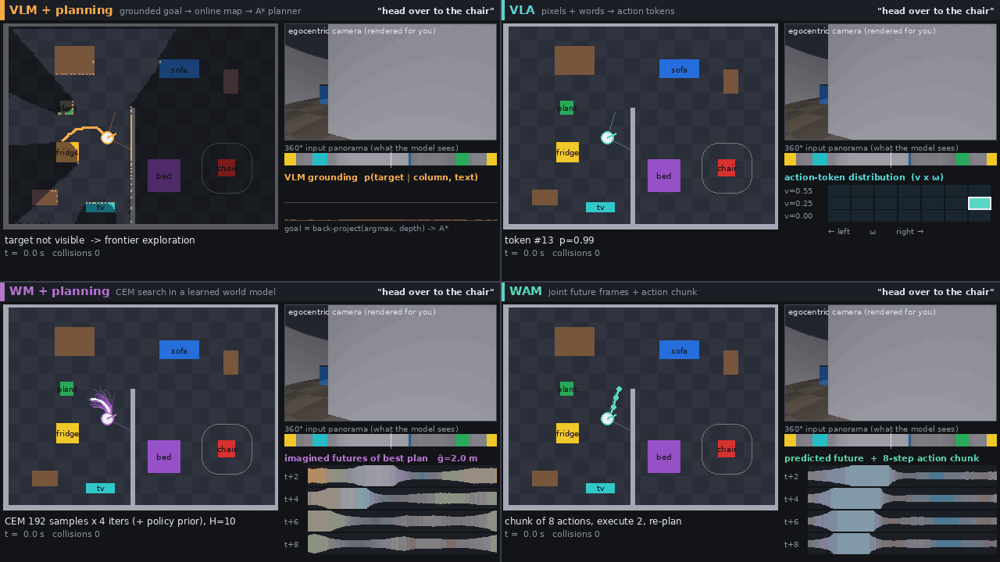

# Navigation Foundation Model

**Four ways to turn "where is the green plant" into motion, side by side in one simulator.**

<p align="center">
  
  <br><sub>Same episode (held-out seed 78), same instruction, four paradigms. Every frame is rendered from the live simulation; the right column of each panel shows what each model is thinking.</sub>
</p>

<table>
  <tr>
    <td width="50%" align="center">
      <br>
      <b>VLM + planning</b><br>
      <sub>A language-grounded detector scores every panorama column for the instructed object; the hit is back-projected with depth into an online occupancy map, and a classical A* planner + pure pursuit drives there. No target in view → frontier exploration.</sub>
    </td>
    <td width="50%" align="center">
      <br>
      <b>VLA (vision-language-action)</b><br>
      <sub>One network maps pixels + words straight to a distribution over 21 discrete (v, ω) action tokens, RT-style. No map and no planner. It is trained by behaviour cloning and then DAgger.</sub>
    </td>
  </tr>
  <tr>
    <td width="50%" align="center">
      <br>
      <b>WM + planning (world model + MPC)</b><br>
      <sub>A latent world model (encoder, action-conditioned dynamics, decoder, goal-distance and collision heads) is searched with CEM: 192 imagined action sequences × 4 iterations every step. The map shows the sampled plans; the strips are decoded imagined futures.</sub>
    </td>
    <td width="50%" align="center">
      <br>
      <b>WAM (world-action model)</b><br>
      <sub>One trunk jointly predicts an 8-step action chunk <i>and</i> the panoramas it expects to see at t+2…t+8. Predicting the future acts as an auxiliary signal for the actions. It executes 2 actions, then re-plans.</sub>
    </td>
  </tr>
</table>

## Results

Held-out evaluation on 100 episodes (seeds 0–99; training uses seeds ≥ 100 000, so layouts, object placements, start poses and instruction phrasings are unseen):

| Paradigm | Success | SPL | Steps to goal (successes) | Collisions / episode | Params |
| --- | ---: | ---: | ---: | ---: | ---: |
| VLM + planning | **0.96** | 0.88 | 50.1 | 4.4 | 0.11 M (+ classical planner) |
| VLA | 0.92 | **0.90** | **37.9** | **4.1** | 0.69 M |
| WM + planning | 0.39 | 0.24 | 76.1 | 4.8 | 0.65 M (+ CEM) |
| WAM | 0.92 | **0.90** | 38.5 | 10.2 | 2.56 M |

`docs/results.json` has per-episode numbers (`python scripts/evaluate.py 100`).

What the numbers say, in this toy setting:

- **VLM + planning** is the most robust because it is the only method with memory: a map, plus frontier exploration when the target is hidden behind a wall. It is also slower, since exploration costs steps.
- **VLA** and **WAM** are reactive and fast. They take near-optimal paths whenever the target is visible in the panorama. They fail when it is occluded, because they have no memory.
- **WM + planning** is the hardest to get right. The planner actively searches for states where the learned goal-distance head is wrong and drives toward them, which is the classic model-exploitation failure. Fine-tuning on the planner's own rollouts raised success from about 0.2 to 0.39. Better value learning, model ensembles or memory are the obvious next steps.

## The simulator

`navfm/world.py` is a small, deterministic object-goal navigation world:

- **Apartment:** randomly generated, 8 m × 6 m. It has tall partial walls that block sight, low furniture that blocks motion but not sight, and six coloured target objects (chair, sofa, plant, fridge, bed, tv).
- **Robot:** a unicycle-model robot with radius 0.18 m and 0.25 s control steps, commanded by velocity (v, ω).
- **Observation:** a 360° ray-cast panorama of 128 columns × (RGB + two depth layers), plus odometry and a free-form instruction such as *"take me to the red chair"* or *"find the fridge"*.
- **Success:** the robot comes within 0.5 m of the instructed object within 160 steps.
- **Expert:** a privileged expert (geodesic distance field + pure pursuit) produces demonstrations and DAgger labels.

The first-person view in the GIFs is a pseudo-3D ray-cast render of the same world, for humans. The models only ever see the 128-column panorama strip shown under it.

## Quickstart

```bash
pip install -r requirements.txt          # numpy, scipy, pillow, torch (CPU is fine)

python scripts/evaluate.py 20            # evaluate the shipped checkpoints
python scripts/make_gifs.py 78           # re-render docs/media/*.gif for seed 78

# retrain everything from scratch (CPU, ~1-2 h total)
python scripts/collect.py 2500 data/expert.npz
python scripts/train.py vlm wm vla wam
```

## Layout

| Path | What |
| --- | --- |
| `navfm/world.py` | simulator: layouts, ray casting, dynamics, observations |
| `navfm/expert.py` | geodesic-field expert used for demonstrations / DAgger labels |
| `navfm/models.py` | the four networks (shared circular-conv panorama encoder + text encoder) |
| `navfm/agents.py` | deployable agents: grounding + A*, token policy, CEM-MPC, chunked WAM |
| `navfm/train.py`, `scripts/train.py` | training loops, DAgger / on-policy fine-tuning |
| `navfm/render.py`, `scripts/make_gifs.py` | hero GIF renderer |
| `checkpoints/` | trained weights used for the GIFs and the table |

## Scope

These models are deliberately tiny (0.1–2.6 M parameters, trained on a CPU) so that the whole pipeline can be rerun and inspected in an afternoon. They implement the architectural *paradigms* behind VLM-based planners, VLAs, world-model planners and world-action models. They are not pretrained foundation models, and the numbers above compare paradigms in this toy world, not published systems.

## License

MIT
